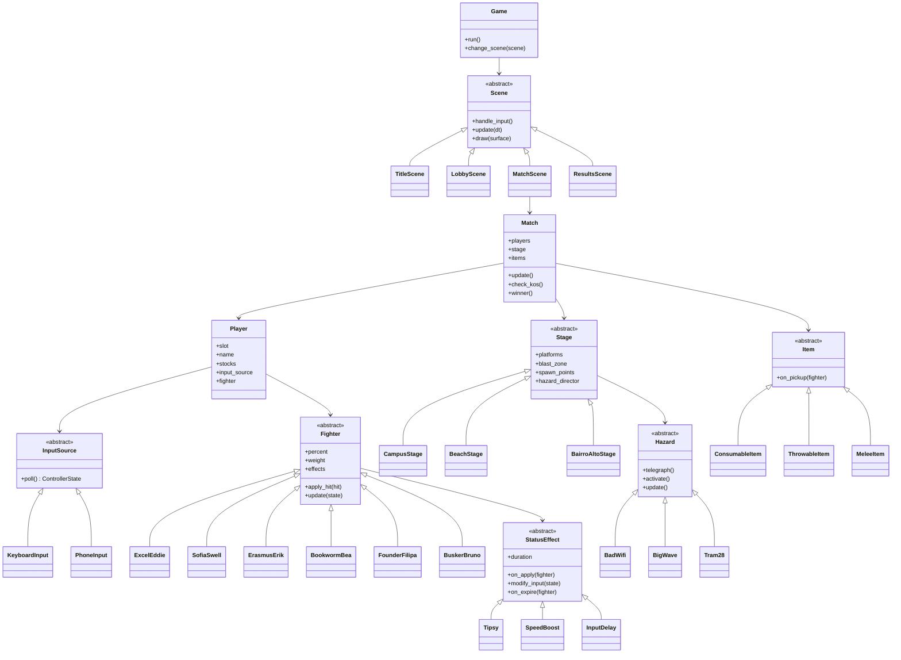
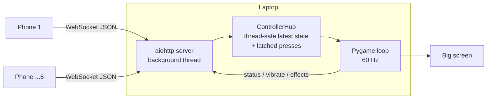

# NOVA Brawl: Specification

> **Historical in parts.** The build follows [`GAME_SPEC.md`](GAME_SPEC.md) (2026-11-11). Where this file disagrees, for example on Python, six players, the shield or the fighter names, `GAME_SPEC.md` wins.


| | |
|---|---|
| **Document** | Functional & technical specification (the *how*) |
| **Related** | [`CONCEPT.md`](CONCEPT.md) (brand, fighters, stages, items) · [`DECISIONS.md`](DECISIONS.md) (every decision) · [`BRAINSTORM.md`](BRAINSTORM.md) (ideas not yet decided) · [`../mockup/index.html`](../mockup/index.html) (visual mock-up) |
| **Version** | 0.2 (draft) |
| **Team** | 2–3 people |
| **Timeline** | 3 weeks |
| **Code** | Python 3.11+ with Pygame (the phone controller page is HTML/JS) |
| **Text language** | **English only**: no Portuguese words or slang ([D-023](DECISIONS.md)) |

---

## 1. Scope & priorities

**Goal:** a playable local-multiplayer platform fighter for 2–6 players. It runs on one laptop/projector and uses phones as controllers (joined via QR code), with 3 stages, 6 fighters, items and stage hazards. It must be good enough for a **live demo** in the course.

**Priority legend (MoSCoW)**

| Tag | Meaning |
|---|---|
| **MUST** | Needed for the MVP / course demo. No demo without it. |
| **SHOULD** | Planned for the 3 weeks, cut only if we run out of time |
| **COULD** | Nice to have, only once everything else works |
| **WON'T (now)** | Explicitly out of scope for this version |

**Definition of MVP:** at least 2 phones join via QR → pick a fighter → fight on all 3 stages with %, knockback, blast zones, 200 % burnout and 3 stocks. Universal items work, and each stage has at least one signature hazard (Bad Wi-Fi, Big Wave, Drinks/Tipsy).

---

## 2. Decisions

All decisions (made and open) live in **[`DECISIONS.md`](DECISIONS.md)**, the single source of truth. This spec only implements them. When a decision changes, update `DECISIONS.md` first, then this file.

Key decisions in short: Python + Pygame · up to 6 players · shared screen + phones as controllers · hybrid KO (knockback + 200 % burnout) · medium moveset · D-pad + buttons · stock mode with 3 lives · Nova SBE setting · fictional student archetypes · flat cartoon style · English only.

---

## 3. Functional requirements

### 3.1 Session & lobby (`F-LOB`)

| ID | Requirement | Priority |
|---|---|---|
| F-LOB-01 | On start, the game shows a **title screen**. Any key or the first phone joining leads to the lobby. | MUST |
| F-LOB-02 | The lobby shows a **QR code** + plain URL that opens the phone controller page | MUST |
| F-LOB-03 | Up to **6 players** can join. A 7th phone gets a friendly "Lobby full" page. | MUST |
| F-LOB-04 | Each joined player appears in a **player card** (P1–P6 slot colour, name, chosen fighter, ready state) | MUST |
| F-LOB-05 | The match starts when **≥ 2 players are ready** and the host starts it (laptop key `Enter` or the P1 phone) | MUST |
| F-LOB-06 | Stage selection by the host (laptop keys or P1 phone), including a **"Random"** option | MUST |
| F-LOB-07 | Match settings: stocks (1–5, default 3), items on/off + frequency, hazards on/off | SHOULD |
| F-LOB-08 | After the match: **Rematch** (same players and fighters) or **Back to lobby** | SHOULD |

### 3.2 Phone controller (`F-CTL`)

| ID | Requirement | Priority |
|---|---|---|
| F-CTL-01 | The controller is a **web page**. No app install, works in iOS Safari and Android Chrome. | MUST |
| F-CTL-02 | Join screen: enter a **name** (max 12 chars), press Join | MUST |
| F-CTL-03 | Select screen: choose **fighter** and press **Ready**. Several players may pick the same fighter. | MUST |
| F-CTL-04 | Match screen in **landscape**: **D-pad** (left) + **A / B / Jump / Shield** (right) | MUST |
| F-CTL-05 | **Multi-touch**: holding a D-pad direction while pressing a button must work | MUST |
| F-CTL-06 | Inputs are sent as **state changes** (press/release). Quick taps must never be lost between two game frames (see §5.5). | MUST |
| F-CTL-07 | A top bar shows **slot, name, current %, remaining lives**, updated live | MUST |
| F-CTL-08 | **Effect banners** with countdown: tipsy (incl. what changed + "Drink water!"), sunburn warning, Bad Wi-Fi ("eduroam: reconnecting..."), hazard warnings. Banners never cover the buttons. | MUST |
| F-CTL-09 | **Vibration** on hit (short) and KO (long) where supported. Screen flash as a fallback (iPhone Safari doesn't support the Vibration API). | SHOULD |
| F-CTL-10 | Screens for **KO'd** ("LAUNCHED! 2 lives left"), **eliminated** ("You're out! Grab a coffee and watch.") and **results** (placement + award) | SHOULD |
| F-CTL-11 | **Reconnect**: if the phone locks or loses the connection, the player keeps their slot for 30 s and rejoins automatically (session token in `localStorage`) | SHOULD |
| F-CTL-12 | "Rotate your phone" hint in portrait mode | SHOULD |
| F-CTL-13 | Pick a slot colour on the phone | COULD |

### 3.3 Match rules (`F-MAT`)

| ID | Requirement | Priority |
|---|---|---|
| F-MAT-01 | **Stock mode**: each player starts with **3 lives** | MUST |
| F-MAT-02 | Damage % starts at **0 %** and is shown on the HUD **at the top** of the screen | MUST |
| F-MAT-03 | **Blast zones**: a fighter crossing the screen edge + margin (left, right, top, bottom) is KO'd ("LAUNCHED!") | MUST |
| F-MAT-04 | **Burnout**: when damage reaches **≥ 200 %** the fighter is KO'd instantly ("BURNOUT!") | MUST |
| F-MAT-05 | A KO costs **1 life**. The fighter respawns on a respawn platform at 0 % with **2 s invincibility**. | MUST |
| F-MAT-06 | With 0 lives the player is **eliminated**. The last player with lives left **wins**. | MUST |
| F-MAT-07 | Countdown "3, 2, 1, BRAWL!" before the match. Inputs are ignored until "BRAWL!". | MUST |
| F-MAT-08 | **Pause** with `Esc` on the laptop (freezes everything, phones show "Paused") | SHOULD |
| F-MAT-09 | A **disconnected** player's fighter stands idle. A "P3 disconnected" badge appears on the HUD. | SHOULD |

### 3.4 Combat & physics (`F-CMB`)

| ID | Requirement | Priority |
|---|---|---|
| F-CMB-01 | Fixed-timestep simulation at **60 updates/s**, independent of render FPS | MUST |
| F-CMB-02 | Movement: walk, jump, **one double jump**, fast fall, air drift, gravity, max fall speed | MUST |
| F-CMB-03 | **Platforms**: solid main platforms + **pass-through** floating platforms (jump up through them, drop down with ↓) | MUST |
| F-CMB-04 | Attacks: neutral, side, up, down (ground and air) + neutral special + up special (recovery), chosen by D-pad direction + button | MUST |
| F-CMB-05 | **Hitboxes / hurtboxes** as rectangles (`pygame.Rect`). Each attack has startup, active and recovery frames. | MUST |
| F-CMB-06 | A hit applies **damage %**, **knockback** (formula §6) and **hitstun**. A fighter can't be hit twice by the same attack instance. | MUST |
| F-CMB-07 | **Weight** reduces knockback (heavier = flies less far) | MUST |
| F-CMB-08 | **Shield**: hold to block. Shield HP drains when hit and regenerates when released. Break = 2 s stun. | MUST |
| F-CMB-09 | **Dodge / roll** (shield + direction) and **air dodge** with invincibility frames and a cooldown | MUST |
| F-CMB-10 | **Projectiles** as their own entities (e.g. Slide Deck, Footnote Barrage) | MUST |
| F-CMB-11 | Hit feedback: short **hit-pause** (freeze frames), screen shake on strong hits, damage number pops | SHOULD |
| F-CMB-12 | **Slopes** with low friction for Bairro Alto (see F-STG-10) | SHOULD |
| F-CMB-13 | Ledge grab | COULD |

### 3.5 Fighters (`F-FTR`)

Details and flavour: [`CONCEPT.md` §4.3](CONCEPT.md#43-roster-student-archetypes).

| ID | Requirement | Priority |
|---|---|---|
| F-FTR-01 | A common `Fighter` base class. Each fighter is a subclass that only defines **stats + moveset**. | MUST |
| F-FTR-02 | **Excel Eddie** (all-rounder) and **Sofia Swell** (fast/light) fully playable | MUST |
| F-FTR-03 | **Erasmus Erik**, **Bookworm Bea**, **Founder Filipa** and **Busker Bruno** playable | SHOULD |
| F-FTR-04 | Passives: Sofia rides the Big Wave, Bea is immune to Exam Season, Erik has halved tipsy duration, Filipa has a larger item pickup range | SHOULD |
| F-FTR-05 | Each fighter has animations: idle, run, jump, fall, attack(s), hurt, shield, KO. Few frames + code-driven squash & stretch are fine. | SHOULD |
| F-FTR-06 | Player-slot outline + "P1"–"P6" label above each fighter | MUST |

**Starting stats (to be tuned):**

| Fighter | Weight | Walk speed (px/f) | Jump velocity (px/f) | Notes |
|---|---|---|---|---|
| Excel Eddie | 100 | 4.5 | −13.0 | Baseline |
| Sofia Swell | 85 | 5.5 | −14.0 | Light, flies further |
| Erasmus Erik | 105 | 4.5 | −12.5 | Strong close range |
| Bookworm Bea | 90 | 3.8 | −12.5 | Projectiles |
| Founder Filipa | 90 | 5.2 | −13.5 | Reflect special |
| Busker Bruno | 125 | 3.5 | −11.5 | Heavy, slow |

### 3.6 Stages & hazards (`F-STG`)

Details and flavour: [`CONCEPT.md` §4.4](CONCEPT.md#44-stages).

| ID | Requirement | Priority |
|---|---|---|
| F-STG-01 | A common `Stage` base class: background layers, platforms, blast zones, spawn points (fighters + items), respawn platform, hazard list | MUST |
| F-STG-02 | Three stages: **Nova SBE Campus**, **Carcavelos Beach**, **Bairro Alto** | MUST |
| F-STG-03 | A **HazardDirector** per stage triggers one hazard at a time every 25–40 s (random), each with a **3 s telegraph** (visual + sound + phone banner) | MUST |
| F-STG-04 | Campus: **Bad Wi-Fi**: all inputs delayed ~200 ms for 6 s, buffering spinner, phones show "eduroam: reconnecting..." | MUST |
| F-STG-05 | Campus: **Exam Season**: 12 s, everyone −25 % speed, falling books (8 % each, shadow telegraph) | SHOULD |
| F-STG-06 | Campus: **Pop-Quiz Professor** NPC walks across. Contact = 10 % + 1 s stun. | SHOULD |
| F-STG-07 | Campus: **Cascais Line train** through the lower lane (20 % + strong horizontal knockback). 25 % chance of **"STRIKE! Train cancelled."** (no train). | SHOULD |
| F-STG-08 | Beach: **Big Wave**: pushes fighters on the sand level towards the edge (+5 %). High platforms are safe. | MUST |
| F-STG-09 | Beach: **Sunburn**: per-fighter sun meter, +1 %/s when full, reset after 3 s in a shade zone | SHOULD |
| F-STG-10 | Beach: **Seagulls** steal a held item or a ground item and drop it elsewhere (2 % peck) | SHOULD |
| F-STG-11 | Beach: **Surfboard** stage item (see F-ITM-07) | SHOULD |
| F-STG-12 | Bairro Alto: **Drinks** spawn as stage items (see F-ITM-08) | MUST |
| F-STG-13 | Bairro Alto: **Tram 28** along street level (25 % + big knockback), bell telegraph | SHOULD |
| F-STG-14 | Bairro Alto: **Steep Alleys**: sloped, low-friction ground. Idle fighters slowly slide downhill. | SHOULD |
| F-STG-15 | Beach background slowly shifts to **sunset** during the match | COULD |
| F-STG-16 | **Global catastrophe events** (blackout, earthquake, heat wave, storm): **to be decided** | COULD |

### 3.7 Items & status effects (`F-ITM`)

| ID | Requirement | Priority |
|---|---|---|
| F-ITM-01 | Items spawn every 12–20 s at stage spawn points, **max 3** on the stage at once | MUST |
| F-ITM-02 | Pick up with **A** while overlapping. Throwables are thrown with **A** + direction. Consumables apply immediately. | MUST |
| F-ITM-03 | **Custard Tart**: heals 20 % (minimum 0 %) | MUST |
| F-ITM-04 | **Book** (throw, 14 %) and **Laptop** (throw, 10 % + 0.5 s stun) | MUST |
| F-ITM-05 | **Espresso**: +30 % movement speed for 8 s | MUST |
| F-ITM-06 | **Sardine**: melee weapon, 5 swings, 6 % but very high knockback growth | MUST |
| F-ITM-07 | **Surfboard** (Beach): ride for 6 s (faster, ram 12 %, immune to Big Wave) or throw | SHOULD |
| F-ITM-08 | **Drinks** (Bairro Alto) give **Tipsy** for **8 s**: *Beer* = random drift, *Blue Drink* = left/right swapped, *Cherry Shot* = up/down swapped. No stacking: a new drink replaces the effect and resets the timer. | MUST |
| F-ITM-09 | Every status effect sends a **phone banner** explaining *what* changed and *for how long* | MUST |
| F-ITM-10 | Status effects as classes: `Tipsy`, `SpeedBoost`, `Stun`, `Sunburn`, `InputDelay`, `Slowdown` | MUST |

### 3.8 HUD & screens (`F-UI`)

| ID | Requirement | Priority |
|---|---|---|
| F-UI-01 | Screens: Title → Lobby → Stage select → Countdown → Match → Results | MUST |
| F-UI-02 | **HUD at the top**: one card per player (slot colour, portrait, name, **big %**, life icons) | MUST |
| F-UI-03 | The % colour shifts white → yellow → red as damage rises. From 150 % a **"BURNOUT WARNING"** pulse appears. | SHOULD |
| F-UI-04 | Big announcer texts: "BRAWL!", "LAUNCHED!", "BURNOUT!", "STRIKE! Train cancelled.", "{name} graduates with honours!" | MUST |
| F-UI-05 | Hazard telegraphs: Tram Yellow / black stripes + icon | MUST |
| F-UI-06 | Results screen with winner and **awards** (see CONCEPT §4.7) | SHOULD |
| F-UI-07 | Internal resolution **1280×720**, scaled to window/fullscreen (`F11`) | MUST |

### 3.9 Audio (`F-AUD`)

| ID | Requirement | Priority |
|---|---|---|
| F-AUD-01 | SFX for hit, KO, jump, item pickup, hazard telegraphs (tram bell, train horn, whistle, seagull) | SHOULD |
| F-AUD-02 | Background music per stage + menu | SHOULD |
| F-AUD-03 | Volume / mute on the laptop (`M`) | SHOULD |
| F-AUD-04 | All audio original or CC0 / CC-BY, credited in `CREDITS.md` | MUST |

### 3.10 Development & debug (`F-DEV`)

| ID | Requirement | Priority |
|---|---|---|
| F-DEV-01 | **Keyboard input for 2 players** (no phones needed for development, and a backup for the demo) | MUST |
| F-DEV-02 | Debug overlay (`F3`): FPS, hitboxes/hurtboxes, per-player input latency, connected clients | SHOULD |
| F-DEV-03 | `tools/fake_controllers.py`: connects N simulated phones that press random buttons, for testing 6 players without 6 phones | SHOULD |
| F-DEV-04 | CLI flags: `--host`, `--port`, `--windowed`, `--stage`, `--debug` | SHOULD |

### 3.11 Out of scope for now (`WON'T`)

Bots / single player, time mode, tournament mode, online play over the internet (unless we choose the cloud relay, §5.4), emotes, tilt controls, a 7th secret fighter.

Not decided yet (see [`BRAINSTORM.md`](BRAINSTORM.md)): login / profiles, persistent stats & leaderboard, XP & levels, unlockable skins, achievements. They move into this spec only after a decision in [`DECISIONS.md`](DECISIONS.md).

---

## 4. Non-functional requirements (`NFR`)

| ID | Requirement |
|---|---|
| NFR-01 | **Performance:** a stable 60 FPS with 6 fighters, 3 items and an active hazard on an average student laptop |
| NFR-02 | **Latency:** median phone → screen input latency **≤ 100 ms** on the demo network (measured with the debug overlay) |
| NFR-03 | **Compatibility:** controller works on current iOS Safari and Android Chrome, in landscape, no install |
| NFR-04 | **Readability:** HUD % and names readable from 3 m on a projector (min. 40 px for % at 720p) |
| NFR-05 | **One-command start:** `pip install -r requirements.txt` then `python -m nova_brawl` |
| NFR-06 | **Robustness:** phones joining, leaving or reconnecting never crash the game |
| NFR-07 | **Testability:** game logic (physics, damage, rules, effects) runs **without a window** (headless) |
| NFR-08 | **Code quality:** PEP 8, type hints, docstrings for public classes/methods, no magic numbers (tuning values in `config.py`) |
| NFR-09 | **Accessibility:** slot colours always paired with P1–P6 labels; no fast flashing (photosensitivity); screen shake can be turned off |
| NFR-10 | **Licensing:** only original or properly licensed assets; no Nintendo IP; no official Nova SBE logo without permission |

---

## 5. Technical architecture

### 5.1 Stack

| Part | Choice |
|---|---|
| Game | Python 3.11+, `pygame` 2.x (or the drop-in `pygame-ce`) |
| Controller server | `aiohttp` (serves the controller page + WebSocket on one port), running in a background thread |
| QR code | `qrcode` + `Pillow`, converted to a Pygame surface |
| Phone controller | Plain HTML + CSS + JavaScript (no framework), Pointer Events for multi-touch |
| Tests | `pytest` (headless via `SDL_VIDEODRIVER=dummy`) |
| Art pipeline | Vector tool (Figma / Inkscape) → PNG sprite sheets at 2× |

### 5.2 Project structure (proposal)

```
Nova-Smash-Bros/
├── README.md
├── requirements.txt
├── CREDITS.md
├── docs/
│   ├── CONCEPT.md
│   ├── SPECS.md
│   ├── DECISIONS.md
│   └── BRAINSTORM.md
├── mockup/
│   └── index.html           # clickable visual mock-up
├── nova_brawl/
│   ├── __main__.py          # entry point: python -m nova_brawl
│   ├── config.py            # all tuning values & constants
│   ├── game.py              # Game: main loop, fixed timestep, scene manager
│   ├── scenes/              # Scene base + Title, Lobby, StageSelect, Match, Results
│   ├── core/
│   │   ├── match.py         # Match: players, rules, KO/burnout, win condition
│   │   ├── physics.py       # gravity, collisions, knockback formula
│   │   └── combat.py        # Attack, Hitbox, Hit, Projectile
│   ├── fighters/            # Fighter base + excel_eddie.py, sofia_swell.py, ...
│   ├── stages/              # Stage base + campus.py, beach.py, bairro_alto.py
│   ├── hazards/             # Hazard base + HazardDirector + bad_wifi.py, big_wave.py, tram.py, ...
│   ├── items/               # Item base + Consumable / Throwable / Melee / Rideable
│   ├── effects/             # StatusEffect base + Tipsy, SpeedBoost, Stun, Sunburn, InputDelay
│   ├── input/               # InputSource base + KeyboardInput, PhoneInput, ControllerState
│   ├── network/             # server.py (aiohttp), hub.py (thread-safe state), protocol.py
│   └── ui/                  # HUD, announcer, banners, fonts
├── controller_web/          # index.html, controller.js, style.css (phone page)
├── assets/                  # sprites/, backgrounds/, sounds/, music/, fonts/
├── tools/
│   └── fake_controllers.py
└── tests/
```

### 5.3 Class overview (OOP)



Key OOP ideas the course can see:
- **Inheritance & polymorphism:** `Fighter`, `Stage`, `Hazard`, `Item`, `StatusEffect`, `Scene` and `InputSource` are abstract base classes with concrete subclasses.
- **Encapsulation:** a `Fighter` changes its own `percent` only through `apply_hit()` / `heal()`.
- **Abstraction:** the game only sees `InputSource.poll()`. It doesn't care whether input comes from the keyboard or a phone. Status effects like `Tipsy` simply **transform the `ControllerState`** (e.g. swap left/right) before the fighter reads it.

### 5.4 Networking: **open decision**

Whatever we pick, `PhoneInput` hides the transport, so gameplay work is never blocked by this decision.

| | **A: Laptop as local server** | **B: Cloud relay** | **C: Both** |
|---|---|---|---|
| How | The game starts an `aiohttp` server. The QR code points to `http://<laptop-LAN-IP>:8080`. | A small relay server on the internet (e.g. Render / Fly.io). Laptop and phones connect to `wss://...` with a room code. | A by default, B as fallback |
| Pros | No internet needed, lowest latency, free, nothing to deploy | Works on **any** network (incl. uni Wi-Fi), HTTPS enables extra browser APIs (e.g. Wake Lock) | Most robust for demo day |
| Cons | **Uni / eduroam Wi-Fi often blocks device-to-device traffic** → use a phone hotspot or travel router. Plain HTTP only. | Extra latency (≈ 30–100 ms), a server to deploy and keep alive, free tiers sleep | Most work |

**Recommendation:** build **A** first (we need it for development anyway), run a **1-day spike in week 1** on the actual demo network and then decide.



### 5.5 Message protocol (WebSocket, JSON)

**Phone → Game**

```json
{"type": "join",   "name": "Ana", "token": "b3f1c2..."}
{"type": "select", "fighter": "sofia_swell"}
{"type": "ready",  "value": true}
{"type": "input",  "seq": 1042, "left": true, "right": false, "up": false, "down": false,
                   "attack": false, "special": false, "jump": true, "shield": false}
{"type": "ping",   "t": 1730640000123}
```

**Game → Phone**

```json
{"type": "welcome", "slot": 3, "color": "#F6C343"}
{"type": "phase",   "value": "lobby | select | countdown | match | ko | eliminated | results"}
{"type": "status",  "percent": 87, "stocks": 2}
{"type": "effect",  "id": "tipsy_blue", "title": "You're tipsy!",
                    "text": "LEFT and RIGHT are swapped for 8 s. Drink water!", "duration": 8}
{"type": "vibrate", "pattern": [40]}
{"type": "pong",    "t": 1730640000123}
```

Rules:
- The phone sends an `input` message **on every change** + a heartbeat every 250 ms.
- The `ControllerHub` **latches button-down events** until the game loop has read them once, so a tap shorter than one frame is never lost (F-CTL-06).
- `status` is sent only when the values change.

---

## 6. Tuning values (starting points, all in `config.py`)

Units: px = pixels at 1280×720, f = frame at 60 Hz.

| Value | Start |
|---|---|
| Gravity | 0.6 px/f² |
| Max fall speed / fast fall | 12 / 18 px/f |
| Air jumps | 1 |
| Blast zone margin | 200 px outside the visible screen (top: 300 px) |
| Respawn invincibility | 120 f (2 s) |
| Burnout cap | 200 % |
| Shield HP / regen / break stun | 50 / 0.15 per f / 120 f |
| Dodge duration / invincible frames / cooldown | 20 f / f4–f16 / 30 f |
| Item spawn interval / max items | 12–20 s / 3 |
| Hazard interval / telegraph | 25–40 s / 3 s |
| Tipsy / speed boost duration | 8 s / 8 s |

**Knockback formula**

```
launch_speed = (attack.base_kb + attack.kb_growth * target.percent / 100) * (100 / target.weight)
hitstun_frames = round(launch_speed * 2.5)
```

- `launch_speed` (px/f) is applied in the attack's angle and decays by 0.4 px/f every frame.
- Example: side attack `base_kb = 6`, `kb_growth = 12`, target at 100 % with weight 100 → 18 px/f (a likely KO). At 0 % → 6 px/f (a small push).

| Attack type | Damage | base_kb | kb_growth |
|---|---|---|---|
| Neutral attack | 3 % | 2 | 3 |
| Side attack | 12 % | 6 | 12 |
| Up / down attack | 8 % | 4 | 8 |
| Air attacks | 6–10 % | 3–5 | 6–10 |
| Specials | per fighter | per fighter | per fighter |
| Sardine | 6 % | 8 | 18 |

---

## 7. Testing strategy

Tests live in `tests/` and run with `pytest`. All game logic runs headless (NFR-07).

| Area | Example tests |
|---|---|
| Damage & knockback | Knockback grows with %, heavier fighters fly less, 0 % still pushes |
| Burnout | A hit that takes a fighter from 195 % to 207 % → instant KO, stock −1 |
| Blast zones | A fighter past `blast_zone.right` → KO, respawn at 0 % with invincibility |
| Match rules | Last player with stocks wins. Eliminated players can't respawn. |
| Status effects | `Tipsy(blue)` swaps left/right in `ControllerState` and expires after 8 s. A new drink resets the timer instead of stacking. |
| Items | The Custard Tart never heals below 0 %. Sardine breaks after 5 swings. Max 3 items on the stage. |
| Hazards | The director never runs two hazards at once. The telegraph always comes before damage. |
| Input | Latched presses: press + release within one frame still registers once |
| Protocol | Valid JSON messages are parsed; invalid or unknown messages are ignored without crashing |

**SHOULD:** a GitHub Actions workflow runs `pytest` on every push.

---

## 8. Course requirements checklist

| Requirement | How we cover it |
|---|---|
| **Object-oriented** | Class hierarchies in §5.3 (7 abstract base classes, ~25 subclasses) |
| **Tests** | `pytest` suite (§7), optional CI |
| **Docs / README** | `README.md` (setup, controls, how to play), `docs/CONCEPT.md`, `docs/SPECS.md`, docstrings |
| **Live demo** | Demo-day checklist (§10), keyboard fallback, own hotspot |
| *More to follow* | *Add here as soon as the course announces them* |

---

## 9. Plan: 3 weeks, 2–3 people

**Roles** (with 2 people, person C's work is split between A and B):

| Role | Owns |
|---|---|
| **A: Gameplay** | Game loop, physics, combat, fighters, items, status effects, match rules, core tests |
| **B: Phone & network** | Server, protocol, ControllerHub, controller web page, lobby, QR, reconnect, fake controllers |
| **C: Stages & look** | Stages, hazards, HUD, art & animation, audio, results/awards, README & demo prep |

**Week 1: Foundation** *(goal: two people fighting on keyboard)*
- Repo setup, `requirements.txt`, game loop with fixed timestep, scene manager
- Campus layout with placeholder rectangles, 2 fighters (Eddie, Sofia) on the keyboard
- Movement, jumps, attacks, hitboxes, %, knockback, blast zones, burnout, stocks, HUD at the top
- **Network spike:** a phone D-pad moves a square on the laptop → **decide on networking (§5.4)**
- First tests for knockback, burnout and stocks

**Week 2: Phones & content** *(goal: the MVP)*
- Lobby with QR, join → select → ready on the phone, up to 6 players, reconnect
- Phone top bar (% and lives), effect banners, vibration
- All 3 stage layouts, universal items, signature hazards (Bad Wi-Fi, Big Wave, Drinks/Tipsy)
- Fighters 3 + 4, first real art pass

**Week 3: Spice & polish** *(goal: demo-ready)*
- Remaining hazards (Exam Season, Professor, Train/Strike, Sunburn, Seagulls, Surfboard, Tram 28, Steep Alleys)
- Fighters 5 + 6 and passives, results screen + awards, audio
- Balancing playtests (at least 2 sessions with 4+ players), bug fixing
- Full test suite, README, `CREDITS.md`, demo rehearsal on the real network

---

## 10. Demo-day checklist

- [ ] Own **phone hotspot or travel router** ready (don't rely on the uni Wi-Fi)
- [ ] Laptop charger, HDMI/USB-C adapter for the projector, sound output tested
- [ ] Game tested on at least one **iPhone and one Android** the day before
- [ ] Phones: brightness up, auto-lock off, browser tabs closed
- [ ] **Keyboard fallback** for 2 players works (if the network dies)
- [ ] A **backup gameplay video** in case everything fails
- [ ] Short script: 30 s pitch → live match → 1 min "how it's built" (OOP diagram, tests)

---

## 11. Open questions

The full list with owners and deadlines is in [`DECISIONS.md` → Open decisions](DECISIONS.md#open-decisions). The ones that block implementation:

| # | Question | Decide by |
|---|---|---|
| O-01 | **Networking:** local server, cloud relay or both? (§5.4) | End of week 1 (after the spike) |
| O-02 | **Global catastrophe events:** which ones, if any? | Week 2 |
| O-03 | **Further course requirements** ("more to follow") | As soon as they're announced |
| O-08 | **Login / profiles:** none, nickname + PIN, or real accounts? | Week 1 (affects storage design) |
| O-09 | **Gamification scope for v1:** stats only, or also XP, achievements and skins? | Week 1 |
